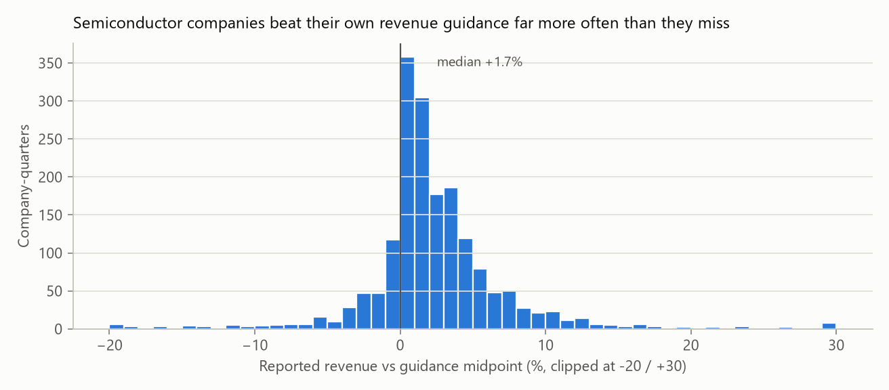
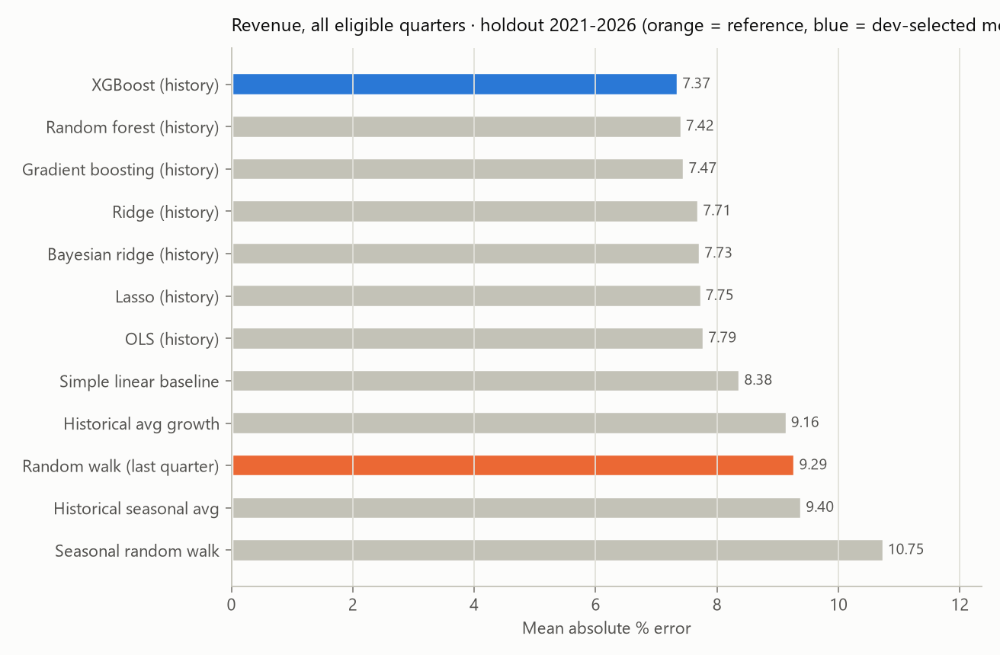
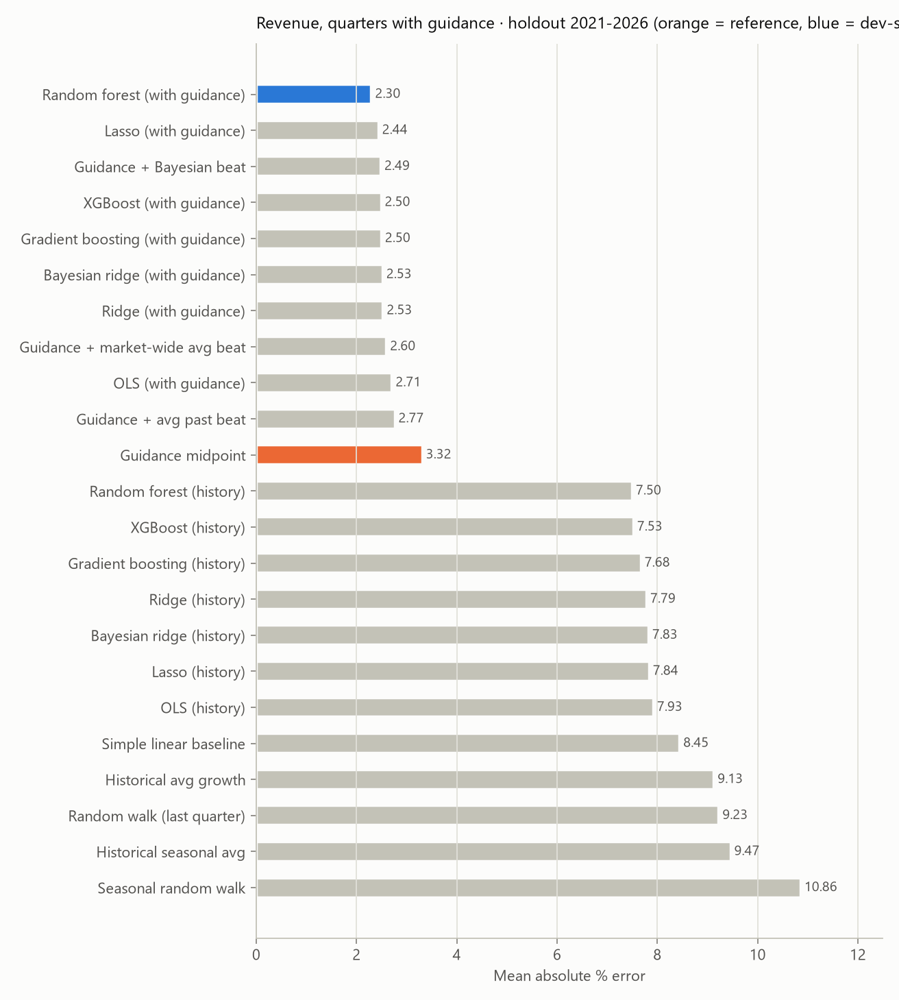
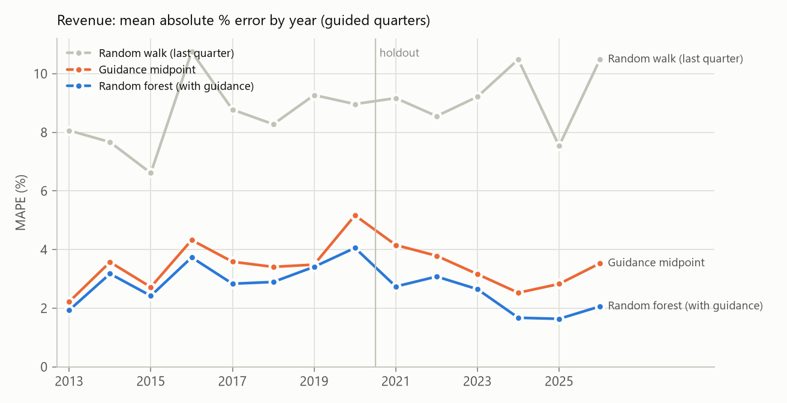
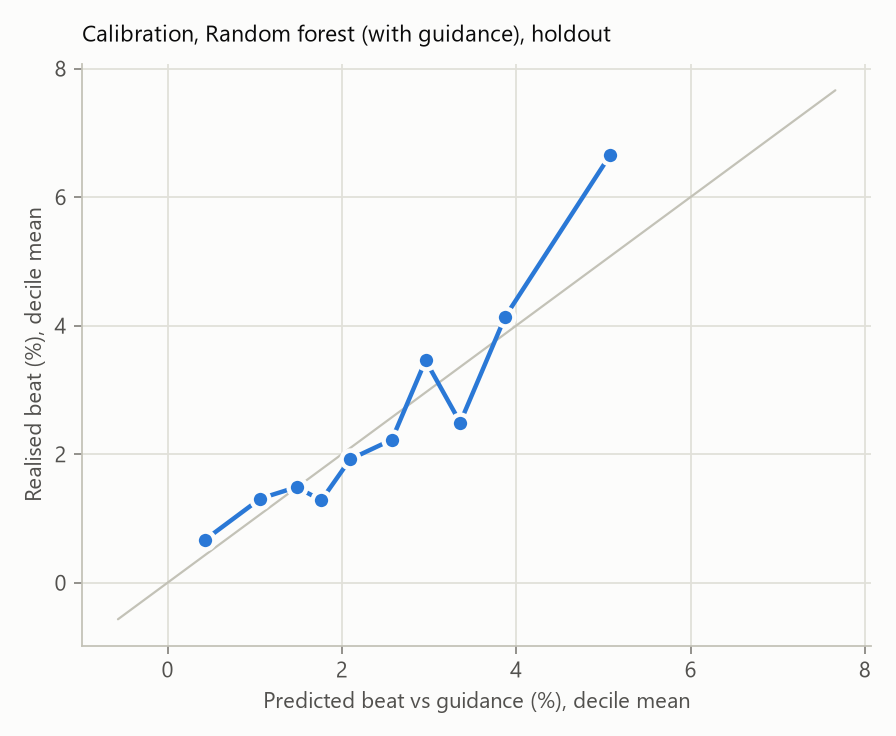
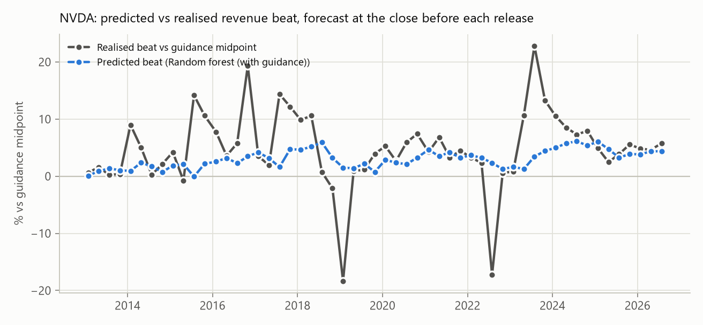
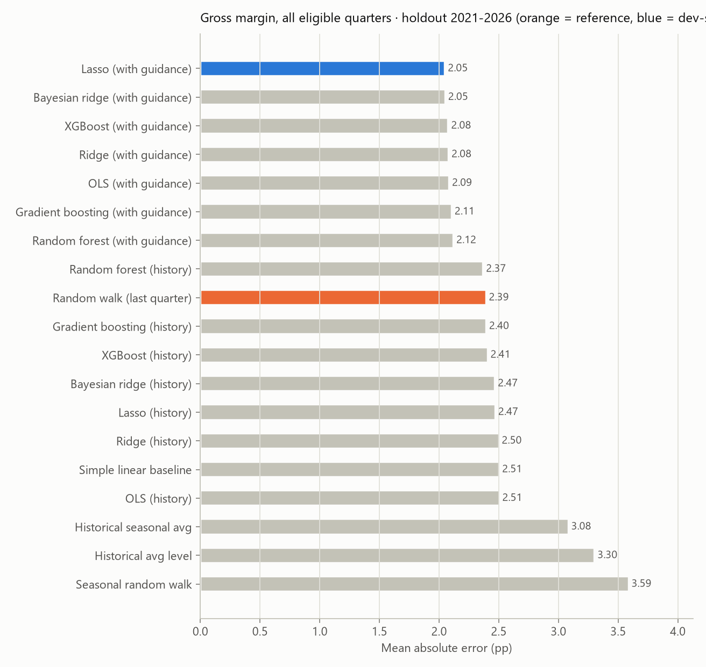
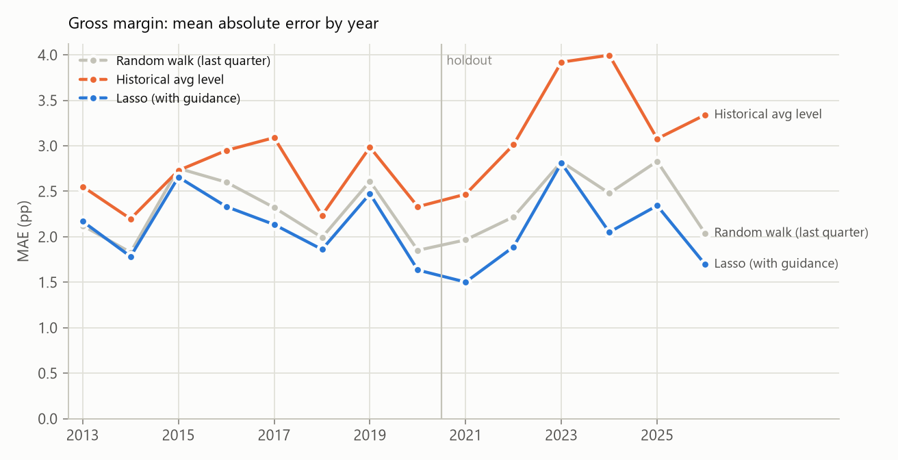

# Forecasting semiconductor revenue and gross margin: phase 1 research report

*fundalpha earnings engine · data as of 2026-11-14 · all forecasts strictly out of sample*

## 1. Bottom line

Headline models were chosen on 2013-2020 forecasts and then run once on a 2021-2026 holdout. MAPE = mean absolute
percentage error; MAE = mean absolute error in percentage points (pp).

| Question | Development 2013-20 | Holdout 2021-26 | Verdict |
|---|---|---|---|
| Can history-only models forecast next-quarter revenue better than random walks, historical averages and linear baselines? | XGBoost 7.03% MAPE vs 8.36% random walk (−16%, t = −7.6) and 7.61% linear baseline (−8%, t = −3.7) | 7.37% vs 9.29% (−21%, t = −3.7) and 8.38% (−12%, t = −3.4) | **Yes, robust**: beats the random walk for 81% / 95% of companies |
| Do they get close to management guidance? | Guidance midpoint 3.59% | 3.32% | **No**: guidance is about 2× more accurate than anything built from history |
| Can a model predict how far reported revenue lands from guidance? | Random forest 3.08% vs guidance midpoint 3.59% (−14%, t = −4.6); vs "guidance + market-wide average beat" −6% (t = −4.4) | 2.30% vs 3.32% (−31%, t = −6.2); vs market-wide beat −12% (t = −6.1); vs Bayesian company beat −7.5% (t = −3.6) | **Yes, robust in size and ranking**: rank correlation of predicted vs realised beat 0.31 / 0.42 |
| Can it call beat vs miss? | 76% correct vs 78% for "always a beat" | 90% vs 90% | **No**: no skill on direction beyond the base rate |
| Gross margin (GAAP) | Lasso 2.14pp MAE vs 2.27pp random walk (−6%, t = −3.4) | 2.05pp vs 2.40pp (−14%, t = −8.3), but only 53% of companies improve | **Small, narrow gain**; history alone does not beat the random walk |
| Gross margin where the company guides on a GAAP basis | Guidance 0.95pp vs model 1.09pp | 1.67pp vs 1.70pp | **Management guidance wins** |

What this means as a fundamental analyst: in semis, the forecast to beat is management's own guidance, and it is
very good. The engine's demonstrable value is in predicting the beat: how far revenue will land from guidance and which
companies will beat by more. It does this from the company's recent beats, peers that have already reported this
season, guided growth and the cycle. It does *not* show skill at calling misses, and nothing here is tested against
analyst consensus or prices. So it is not yet evidence of an earnings-surprise or return signal (§10).

## 2. The question and the set-up

**Industry.** US-listed semiconductors and semiconductor equipment. Chosen because the companies (a) give explicit
quarterly revenue and margin guidance in their earnings releases, which yields a point-in-time "street-like"
anchor without licensed consensus, (b) are deeply cyclical, so a naive extrapolation is genuinely hard to beat, and
(c) report in a staggered season (TSMC-linked foundry and equipment names early, NVIDIA/Marvell/Broadcom late), so
earlier reporters carry information about later ones.

**Universe.** 50 companies: 37 currently listed large/mid caps and 13 acquired ones (Broadcom Corp, Xilinx, Altera,
Mellanox, Cavium, LSI, Maxim, Linear, Freescale, Microsemi, Cypress, IDT, SanDisk) plus Qorvo, delisted on its
acquisition by Skyworks (2026-10-05). Keeping acquired companies removes the survivorship bias of studying only
today's winners. A company-quarter enters the evaluation sample only if its trailing-four-quarter revenue, as known
at the forecast origin, was at least $500M. That keeps roughly 33 companies per quarter in the sample (target range 20-50).

**Targets and horizon.** One fiscal quarter, forecast at the *last market close before the company releases that
quarter* (the quarter is over but not yet reported, which is when an earnings forecast is actually used):

| Target | Definition | Forecast becomes |
|---|---|---|
| Revenue | log(revenue_t / revenue_t-1) | revenue_t-1 × exp(forecast) |
| Revenue vs guidance ("beat") | log(revenue_t / guidance midpoint_t) | guidance × exp(forecast) |
| Gross margin | GAAP gross margin_t − gross margin_t-1 (pp) | gross margin_t-1 + forecast |

Targets are the *first-reported* values (the 10-Q/10-K that first carried the quarter). Features use whatever was
on EDGAR before the origin, including later restatements of older quarters.

**Data (all public, all point in time).**

| Source | What | Volume |
|---|---|---|
| SEC XBRL companyfacts | income statement, cash flow, balance sheet; every vintage with its filing timestamp | 208k facts → 66.6k quarterly vintages |
| SEC submissions | 8-K Item 2.02 acceptance timestamps → release time, BMO/AMC session, forecast origin | 2,756 quarterly releases |
| 8-K EX-99 exhibits | management outlook: revenue range, GAAP / non-GAAP gross margin | 3,198 releases → 2,161 guided quarters |
| Hyperscaler 10-Q/10-K | MSFT, GOOGL, AMZN, META capex (AI-infrastructure demand indicator) | same vintage engine |

Not used: analyst consensus (not licensed here; the engine takes CapIQ / LSEG I/B/E/S history when supplied),
call transcripts, prices.

## 3. Guidance: what the data say before any model

Across 1,777 eligible quarters with revenue guidance (47 companies, 2010-2026):

* Reported revenue beat the guidance midpoint **82%** of the time; median beat **+1.7%**, mean +2.4%, interquartile
  range +0.3% to +4.0%.
* 57% landed inside the guided range, **36.5% above the top** and only **6.3% below the bottom**. The median range is
  ±2.9% around the midpoint.
* Beats are cyclical. Beat rates were 58-62% in the 2011-12 slowdown and 68% in 2015 and 2019, and 91-95% in 2021 and 2024-26.
* By sub-industry, equipment & materials beat most consistently (87% of quarters, median +2.8%). Digital/compute
  overshoots the top of the range most often (45% of quarters).
* Beats are persistent and contagious, but only weakly. The correlation of a company's beat with its own trailing
  average beat is 0.13, and with the average beat of peers that already reported this season 0.14.

The first two facts set the bar for the models: "guidance plus a constant ~2%" is already a strong forecast. A model
has to know which companies beat by more, and when.

## 4. Benchmarks and models

| Code | Model | Information |
|---|---|---|
| B0 | Random walk: next quarter = last quarter | own history |
| B1 | Seasonal random walk: last year's same-quarter sequential change | own history |
| B2 | Historical average: mean sequential growth (8 quarters) / mean GM level (4 quarters) | own history |
| B3 | Historical seasonal average: mean same-quarter change over 3 years | own history |
| L1 | Simple linear baseline: pooled OLS on 3-4 lags | own history |
| G0 | Management guidance midpoint (consensus proxy) | guidance |
| G1 | Guidance + the company's average past beat (8 quarters) | guidance + track record |
| G2 | Guidance + Bayesian (empirical-Bayes) shrunken company beat | guidance + track record |
| M1-M7 | OLS, Ridge, Lasso, Bayesian ridge, random forest, gradient boosting, XGBoost | all features |

Fitted models come in two information sets: *history* (own financials, seasonality, balance sheet, peers already
reported this season, hyperscaler capex) and *with guidance* (adds guidance, guidance width, the company's beat record
and peers' beats this season; the target becomes the beat, anchored on guidance). Hyperparameters were fixed before
testing (`fundalpha/models.py`); ridge and lasso choose their penalty inside each training window.

## 5. Validation protocol

* **Walk-forward, expanding window.** For each calendar quarter from 2013Q1 the models are refit on every
  company-quarter whose results were public before the window started, then forecast the releases inside the window.
* **Development vs holdout.** Model and feature choices were made on 2013-2020 forecasts only. The 2021-2026 holdout
  was run once, after the specification was frozen. Headline models are the best ones *on development data*.
* **Significance.** Panel Diebold-Mariano test: per calendar quarter, the cross-sectional mean loss difference vs
  the reference; Newey-West t-statistic (4 lags) across quarters, so correlated errors inside one reporting season
  are not counted as independent evidence.
* **Point-in-time audits** (`tests/test_pit.py`): origin precedes release; guidance issued before origin; lagged
  values equal the vintage known at the origin; no vintage of the target quarter exists before the origin (this
  audit caught three Diodes quarters whose 10-Q preceded the 8-K, now fixed); training windows end before test
  origins.

## 6. Results: revenue

**All eligible quarters, history-only information** (1,071 forecasts in 2013-20, 809 in 2021-26). Every fitted model
beats every naive benchmark in both periods. The seasonal random walk and the historical averages do *not* beat the
plain random walk. Semiconductor seasonality is weak relative to the cycle, so extrapolating last year's pattern
adds noise.

| Model | MAPE dev | MAPE holdout |
|---|---:|---:|
| Random walk (last quarter) | 8.36 | 9.29 |
| Seasonal random walk | 9.49 | 10.75 |
| Historical average growth | 8.80 | 9.16 |
| Historical seasonal average | 7.95 | 9.40 |
| Simple linear baseline (pooled OLS, 3 lags) | 7.61 | 8.38 |
| OLS / Ridge / Lasso / Bayesian ridge (history) | 7.08-7.25 | 7.71-7.79 |
| Random forest / gradient boosting (history) | 7.03-7.09 | 7.42-7.47 |
| **XGBoost (history), dev-selected** | **7.03** | **7.37** |

**Quarters with guidance** (850 dev, 776 holdout). Here the target becomes the beat, anchored on the guidance midpoint.

| Model | MAPE dev | MAPE holdout | Rank corr. of beat, dev / holdout | Beat-direction hit (base rate) |
|---|---:|---:|---:|---:|
| Guidance midpoint (management) | 3.59 | 3.32 | – | – |
| Guidance + company's average past beat | 3.68 | 2.77 | 0.20 / 0.31 | 66% / 84% (78% / 90%) |
| Guidance + market-wide average beat | 3.26 | 2.60 | ≈0 | 78% / 90% (78% / 90%) |
| Guidance + Bayesian shrunken company beat | 3.29 | 2.49 | 0.21 / 0.31 | 76% / 90% |
| Ridge / Lasso / Bayesian ridge (with guidance) | 3.19-3.21 | 2.44-2.54 | 0.18-0.25 / 0.28-0.29 | 76-78% / 90% |
| XGBoost / gradient boosting (with guidance) | 3.26-3.29 | 2.50 | 0.27-0.28 / 0.32-0.33 | 71-72% / 86-87% |
| **Random forest (with guidance), dev-selected** | **3.08** | **2.30** | **0.31 / 0.42** | 76% / 90% |
| Best history-only model on the same quarters | 7.16 | 7.50 | – | – |

The random forest beats every guidance-based benchmark in both periods. The strictest test is against the
*Bayesian* beat model, which already knows each company's track record: −6.3% MAPE in dev (t = −3.0) and −7.5% in
the holdout (t = −3.6). The gain is in the size of the beat. On direction, no model is better than "always predict a
beat", because 78-90% of quarters are beats.

Calibration holds out of sample: forecasts sorted into predicted-beat deciles line up with the realised beats. The
top decile is slightly under-predicted (predicted +5.1%, realised +6.6%), so the largest beats were bigger than the
model expected. NVIDIA is the archetype:

The model learns the habitual beat (+2% to +6% for NVIDIA) and tracks it well since 2023. It does not see regime breaks:
the crypto-bust misses (−18% in early 2019, −17% in mid-2022, the latter pre-announced) and the size of the first
AI-era beats (+23% in mid-2023). Those are the quarters that matter most for a stock, and they are exactly where
guidance-anchored models are weakest. They need alternative data (channel inventory, hyperscaler orders, crypto
mining economics), not more of the same features.

## 7. Results: gross margin

GAAP gross margin is much harder to improve on.

| Model | MAE dev (pp) | MAE holdout (pp) |
|---|---:|---:|
| Random walk | 2.27 | 2.40 |
| Seasonal random walk / historical averages | 2.64-3.47 | 3.08-3.59 |
| Simple linear baseline | 2.28 | 2.51 |
| Best history-only fitted model | 2.24 | 2.37 |
| **Lasso (with guidance features), dev-selected** | **2.14** | **2.05** |

* Every historical-average benchmark is *worse* than the random walk, and history-only ML ties it. GAAP margins move
  on one-offs no model sees coming: inventory write-downs (Micron FQ2-23 at −33%), acquisition step-ups, contract
  charges (AMD Q1-12 at 2%).
* Adding guidance features (guided revenue growth, the company's margin-beat record, peers' beats) helps: −6% in dev
  (t = −3.4) and −14% in the holdout (t = −8.3). But the gain is narrow, with only 53% of companies improving in the
  holdout. It comes from memory and compute names with large swings.
* Where the company guides gross margin on a GAAP basis (about a third of quarters), its guidance (0.95pp dev, 1.67pp
  holdout) is at least as good as any model (best 1.09pp / 1.70pp).

The guided lasso beats the random walk in 13 of 14 years; 2013 is the exception (+2%). In 2023, the year of
inventory write-downs across the memory and analog downturn, it only ties (−0.5%).

## 8. What drives the forecasts

Gain importance of the guided revenue model, fitted on data public before 2021, ranked:

1. The company's **last beat**, then its median beat over 8 quarters (persistence of management conservatism).
2. **Sub-industry**: equipment and compute names beat by more.
3. **Peers' beats earlier in the same season**, across the universe and within the sub-industry (season-wide demand
   surprises).
4. **Guided growth and guidance width**: wide ranges and conservative-looking guides precede larger beats.
5. **Hyperscaler capex acceleration** and peers' year-on-year growth (the cycle).
6. Recent sequential growth, operating margin and goodwill jumps (a quarter that includes a fresh acquisition).

Full table: `out/importance_rev_guided_2020.csv`; linear coefficients point the same way.

## 9. Robustness

All figures are for the dev-selected model against its reference (`out/robustness.csv`).

| Check | Revenue, history vs random walk (dev / holdout) | Revenue, guided vs guidance midpoint | Revenue, guided vs market-wide beat |
|---|---|---|---|
| All quarters | −16% / −21% | −14% / −31% | −6% / −12% |
| Excluding M&A quarters (goodwill +20% or ±40% growth) | −14% / −21% | −15% / −32% | −5% / −13% |
| Excluding NVIDIA | −15% / −21% | −14% / −30% | −5% / −11% |
| Companies where the model wins | 81% / 95% | 79% / 89% | 74% / 81% |
| Reporting quarters where the model wins | 91% / 79% | 84% / 96% | 78% / 96% |

* Against the guidance midpoint, the guided model improves the error **in every year from 2013 to 2026**: from −2%
  in 2019 to −42% in 2025.
* It also wins in every sub-industry. The weakest is digital/compute in dev (−7%), the strongest equipment &
  materials (−21% dev, −38% holdout).
* The holdout gain is larger than in dev because 2021-26 beats were larger and more predictable (the AI build-out).
  That is a regime the training data barely contained, and it is a reason not to extrapolate the holdout number.

## 10. Verdict

Against the project's standard (no claim without robust out-of-sample evidence):

1. **Revenue forecasting from public history: demonstrated.** The fitted models beat historical averages, random
   walks and simple linear baselines in both periods, across companies, sub-industries and years. This matters
   wherever guidance does not exist: companies that don't guide, longer horizons, segment builds.
2. **Predicting the revenue beat vs management guidance: demonstrated for size and ranking, not for direction.** The
   model knows *which* companies will beat by more (rank correlation 0.42 in the holdout) and gets closer to the
   reported number than guidance (−31%) or any naive beat rule (−7.5% to −12%).
3. **Gross margin: modest.** Aggregate gains over the random walk are significant but narrow, and management's GAAP
   margin guidance is unbeaten.
4. **Earnings (EPS) surprises and returns: not tested.** There is no analyst consensus here, and the street already
   expects semis to beat guidance (consensus usually sits above the midpoint). A predicted beat vs *guidance* is
   therefore not a predicted surprise vs *consensus*. That test needs consensus history (§12) before any alpha claim.

### Live forecasts (as of 2026-11-14; refit on all public data, read with the track record above)

| Company | Status | Guidance midpoint | Model | Predicted beat | Company's avg past beat |
|---|---|---:|---:|---:|---:|
| NVIDIA (Q3 FY27, ended 2026-10-25) | awaiting release | $108.0B | $112.8B | +4.5% | +5.0% |
| Analog Devices (Q4 FY26) | awaiting release | $4.30B | $4.44B | +3.2% | +3.3% |
| Credo (Q2 FY27) | awaiting release | $530M | $546M | +3.1% | +8.7% |
| Broadcom (Q4 FY26) | awaiting release | $34.8B | $35.4B | +1.6% | +1.3% |

Peers that reported this season beat their guidance by +3.7% on average (28 companies). Applied Materials and
Marvell have already put out results that are not yet in XBRL. Forecasts for quarters still in progress (Micron
+6.8%, Cirrus +4.8%, ...) are in the dashboard but come with less information than the backtest had.

## 11. Limitations

* **Guidance is parsed text.** Coverage is 78% of releases. Companies that gave outlook only on the call have little
  or none (KLA before 2016, Micron before FY2020, Altera, Cavium, IDT). A random audit of 25 revenue rows found no
  parse errors. Gross-margin guidance needed two rounds of fixes; the last audit found 19 of 20 correct.
* **GAAP vs non-GAAP.** Targets are GAAP gross margin; most companies guide non-GAAP margin, so the GM guidance
  benchmark covers only GAAP-basis outlooks (about a third of quarters).
* **Release time** is the 8-K acceptance time, which can trail the wire release by minutes.
* **Researcher look-ahead.** The feature set was designed in 2026 with knowledge of the AI cycle; the holdout guards
  against fitting to it, but not against choosing features that were obvious only in hindsight. The hyperscaler-capex
  feature is the clearest example.
* **No consensus, no prices.** Revenue "surprise" here means versus management guidance, not versus the street.

## 12. Next steps (in order of value)

1. **Consensus history.** A licensed point-in-time revenue/EPS consensus export (CapIQ estimates history or LSEG
   I/B/E/S; `data/consensus/*.csv`, schema in `fundalpha/consensus.py`) turns the beat model into a true surprise
   model and adds benchmark C0 automatically.
2. **Prices and the event study.** Add daily prices (Cboe history works for current names; acquired names need
   CapIQ/CRSP) and test whether the predicted beat, net of consensus, predicts the BMO/AMC-aligned announcement return
   and post-earnings drift, after costs and gaps. This is the bridge from forecast accuracy to alpha.
3. **Financial-statement engine.** Extend from revenue/GM to opex, taxes, share count and EPS with a driver build
   (semis: units x price x mix from segment disclosures; equipment: bookings/backlog).
4. **More point-in-time demand indicators.** TSMC monthly revenue (6-K), Korean chip exports, WSTS, memory pricing.
5. **Transcripts.** Run NLP on the call transcripts (CapIQ). Guidance tone is the obvious candidate for the miss side,
   where this model has no skill.
6. **Other sectors** from the spec (industrials, defense tech, AI infrastructure), each with its own guidance parser
   checks.

## Files

| What | Where |
|---|---|
| Code | `fundalpha/` (pipeline, PIT engine, guidance parser, models, walk-forward, evaluation) |
| Metric tables (all models, both periods) | `reports/tables.md`, `out/metrics_*.csv` |
| Out-of-sample predictions | `out/predictions_all.pkl` |
| Feature panel | `out/panel.csv` |
| Guidance | `out/guidance.pkl`, SQLite table `guidance` (with source snippet and 8-K accession) |
| Robustness | `out/robustness.csv` |
| Live forecasts | `out/live_forecasts.csv` |
| Dashboard | `reports/dashboard.html` |
